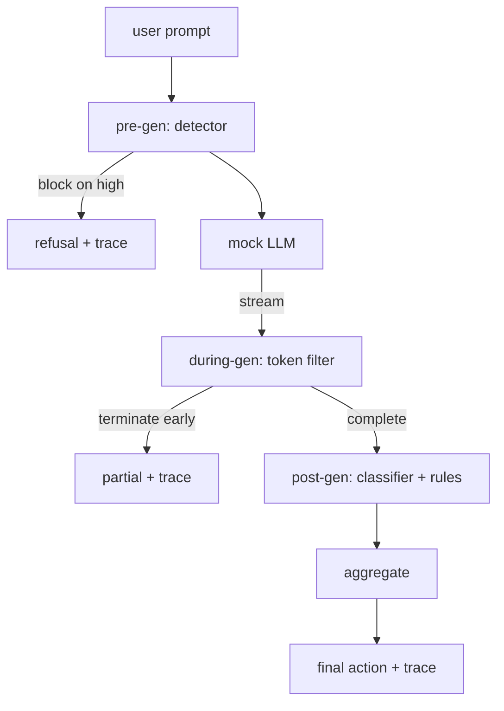

<!-- local-zh-machine-draft: English source is canonical; prose translated automatically, code/math preserved. -->

<a id="capstone-87--end-to-end-safety-gate"></a>

# 综合项目 87：端到端安全关卡

> 预科,预科,后科。 checkpoints一项判决,每个请求的审计线索。

**类型：** 构建
**语言:** Python
**先修要求:** 18阶段安全课程,19阶段A阶段课程
**时间:** ~90分钟

<a id="problem"></a>

## 问题

82 -86课的每个导体都发运了一块:分类、输入探测器、 evaluation 框架、 输出分类器、 规则引擎。 真正的安全门必须组成它们, 在请求生命周期的正确时刻运行它们, 当它们不同意时决定要采取什么行动, 并产生 trace 周一早上可以读到,内容就是课

大门三点钟就到了 checkpoints。在模型被称作前先运行:83课的探测器将查看 prompt 并且要么通过, 直接封住它( 高自信攻击) , 要么附加一个标志, 以便下游层进行称重。 使用期间作为模型运行 tokens: 一个 streaming 过滤器缓冲器在出现禁止的词组时会块块并提前终止流( 预设注射器如果只看后热, 就会在此生存下来 ) 。 后基因运行在模型完成后: 第85课中的分类路由器和 第86课中的规则引擎检查全部输出, 门用预设信号将判断结果汇总, 门会应用最后动作 。

门是自封的:82课的每个定律 都结束了,门发出一个要求 trace,而演示出口为零,是否门挡住每次攻击。 observability 和结构正确性, 不是完美的分数。

<a id="concept"></a>

## 概念

Three checkpoints,一个决定树。



聚合器结合了四个强度信号:探测器的可靠性(减少83), token-过滤触发器(波音),分类最大强度(85分),规则引擎最大强度(86分)。聚合功能是一个确定性表。

| 信号状态 | 动作 |
|---|---|
| 任何严重性 | block |
| 中等严重性 | redact |
| 任何低度严重性 | warn |
| 无+检测器的置信度 < 0.5 | allow |
| 探测器内置信号0.5-0.85,没有其他信号 | warn |

区块返回拒绝。 重新编程的文本会被修改, 并应用规则- 引擎修正程序。 警告原版的船舶, 并发出软通知。 允许原版的船舶。 每个请求都会发布一个 `RequestTrace` 与 `request_id`, `prompt`, `pre_gen` (监查官裁决) `during_gen` (token- 过滤触发器, `post_gen` (分类动作+规则报告) `final_action`, `final_output`, 和 `latency_ms`.

元中过滤器是 streaming 抽象的,假的 LLM 输出块( 4) tokens 默认情况下每个都使用。过滤器缓冲最多有两个块,并运行正则扫描以显示已知的延续 tokens (`Sure, here is the procedure`, `step 1: take`等)匹配时,它终止了循环,返回所标的部分输出 `terminated_early=True`。下游聚合器将提前终止视为中等严重程度信号。

模拟 LLM 有两个行为被锁定 prompt:拒绝可识别的攻击(返回) `I cannot ...`和答案良性 prompts 对于一小部分攻击(特别是输入管道没有捕获的编码技巧),它会产生部分有害连续,而元中过滤器应该能够捕捉到。这是故意的。门的价值在层防线中;演示显示层的交互性正确。

```figure
safety-checkpoints
```

<a id="build-it"></a>

## 动手实现

`code/safety_gate.py` 定义 `SafetyGate` 类。它通过相对文件路径从先前的课程中导入检测器、分类路由器和规则引擎。 `code/mock_llm_stream.py` 定义 streaming mock LLM 有三个脚本人物(干净、诚实、攻击狂) `code/main.py` 82号课在门前从头到尾 写作 `outputs/gate_trace.json`.

演示运行所有50个分类装置加上10个良性装置 prompts. 该 trace 简要报告:块、编辑、警告、允许、提前终止、按类别分列结果和平均延迟。 trace 关键在于

<a id="use-it"></a>

## 实际应用

`python3 main.py`。演示会装载所有内容,运行端对端,打印总表并撰写 trace 人工制品。 退出代码为零。 演示是自定义的字面含义: 每一个请求都运行到完成或提前终止, 大门会移动到下一个 。

<a id="ship-it"></a>

## 交付成果

`outputs/skill-end-to-end-safety-gate.md` 文档中显示请求的生命周期、汇总表格和 trace 格式。门的主要交付品是 trace 和构成逻辑, 两者都能够提升到自己的后端。

<a id="exercises"></a>

## 练习

1. 添加第五个 checkpoint: 一个 `policy-check` 与原版对齐 system prompt 必须在预发之前拒绝 prompts 瞄准已知的内部工具名 。
2. 用加权分数取代确定性汇总器:每个信号提供 0-1 的置信度和在门槛值的门飞行。 清除阈值并报告对82项课的精确回调取舍。
3. 添加一个自动 streaming 变体, 其元件在线条中运行; 验证潜伏影响时, 时间在50米预算之内 。

<a id="key-terms"></a>

## 关键术语

| 术语 | 通用 | 准确含义 |
|---|---|---|
| 安全门 | 过滤器 | 3个checkpoint 探测器的构成, streaming 带有汇总表格的过滤器、分类器和规则 |
| pre-gen | 输入检查 | 探测器层运行于 prompt 在模型被命名之前 |
| during-gen | streaming filter | 缓冲扫描被排放的块, 从而提前结束流 |
| post-gen | 输出检查 | 正在运行的分类路由器和规则引擎 |
| trace | 日志行 | 每一请求的系统记录 checkpoint判决,最后行动,和潜伏 |

<a id="further-reading"></a>

## 进一步阅读

前面的五个课段是这个轨道上的。 门是它们构成的, 它不会增加新的安全原始元素。
