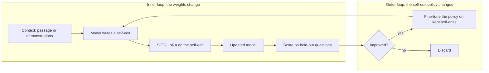

# Self-Edits to Weights: SEAL and the Outer RL Loop

> In June 2025 an MIT group (Zweiger, Pari, Guo, Akyürek, Kim and Agrawal, arXiv:2506.10943, revised 18 September 2025) trained a language model to write its own finetuning data and choose its own hyperparameters, then applied the result to its own weights. On a simplified few-shot ARC subset, Llama-3.2-1B-Instruct went from 0% with in-context learning and 20% with untrained self-edits to 72.5% once the self-edit policy had been trained by reinforcement learning. The persistence is real: unlike the frozen-weight loops of Lesson 09, the model that comes out is a different model. The limits are equally real: every reward signal cost a 30 to 45 second finetune, and accuracy on earlier passages fell as self-edits accumulated. This lesson is about what changes when the thing being rewritten is the weights, and what still does not.

**Type:** Learn
**Languages:** Python (stdlib, SEAL-style self-edit outer-loop simulator)
**Prerequisites:** Phase 10 · 06 (SFT), Phase 10 · 07 (RLHF), Lesson 05 of this phase
**Time:** ~60 minutes

## Learning Objectives

- Define a self-edit and separate its three ingredients: restated data, augmentation choices, and hyperparameters or tool calls.
- Trace SEAL's two nested loops and state which loop changes the weights and which changes the self-edit policy.
- Reproduce the paper-reported numbers with their caveats, including the settings where GPT-4.1-generated data still wins.
- Place SEAL on the ladders from Lesson 01 and argue why persistent weight change does not by itself make a loop closed.
- Name four failure modes (forgetting, compute, reward leakage, disposition entrenchment) and the check that catches each.
- Run the simulator and read a forgetting curve against a new-task accuracy curve.

## The Problem

Every loop in Lessons 04 to 07 left the weights in the hands of a human-written training recipe. STaR, ReST-EM and rejection sampling (Lesson 05) let the model generate and filter its own training examples, but a fixed script decided how those examples were formatted, how many epochs ran and at what learning rate. Self-rewarding models (Lesson 06) let the model grade; the zero-data loops of Lesson 07 let it propose tasks. None of them let it decide *how it should be updated*.

That is a strange gap. When a person learns from a passage they do not re-read it verbatim; they restate it, draw implications, connect it to what they already know and decide how much attention it deserves. A language model shown a new document gets one pass of next-token prediction on the raw text, which incorporates facts poorly: in SEAL's own baseline, finetuning Qwen2.5-7B on a passage moved no-passage question accuracy from 32.7% to 33.5%. The standard 2025 fix was to have a stronger model write synthetic restatements. SEAL asks whether the model can learn to write its *own* update, and whether a reward computed on the updated model is enough to teach it.

The engineering answer matters beyond knowledge incorporation. A model that writes the data it trains on, and picks the optimizer settings, is a step closer to a system that shapes its successor. Phase 18 · 06 called the speculative end of that road gradient hacking. SEAL is not gradient hacking. It is a reminder that the machinery for a model to influence its own weights now exists as a published recipe with code on GitHub, and that the recipe's reward never looks at anything but the task in front of it.

## The Concept

### What a self-edit is

SEAL defines a self-edit as a generation that, when consumed by a fixed finetuning procedure, produces a weight update. The paper's two domains use different ingredients:

| Ingredient | Knowledge incorporation (SQuAD passages) | Few-shot ARC |
|---|---|---|
| Restated data | A list of implications "derived directly or indirectly from the content" of the passage | None; the demonstrations are given |
| Augmentation choices | Implicit in which implications get written | JSON flags: basic, size, chain and repeat transforms of the demonstrations |
| Hyperparameters / tool calls | Fixed in the single-passage runs; a search space over LoRA rank, alpha, learning rate, epochs and batch size is described | Learning rate, number of epochs, and whether the loss covers all tokens or output tokens only |

The important move is that the *same model* writes the self-edit and receives it. A self-edit is text, so it can be sampled, scored and reinforced like any other output. It is also an instruction to a training tool, so it changes weights. Those two properties, scorable text with a persistent effect, are the whole design.

### Two nested loops



The inner loop is ordinary supervised finetuning: generate a self-edit from the current model, apply it with LoRA (rank 32 to 128 depending on the experiment), measure the updated model on questions it has not seen. The outer loop is reinforcement learning on the self-edit policy with the inner loop's score as reward. SEAL tried GRPO-style on-policy methods, found the training unstable, and settled on ReST-EM (Singh et al., TMLR 2024, arXiv:2312.06585), the expert-iteration recipe from Lesson 05: sample several self-edits per context (five per passage over fifty passages for two rounds; fifteen per ARC task), assign a binary reward (1 if the updated model does better, else 0), keep the positives and fine-tune the policy on them.

Two details are easy to miss. First, the weights the inner loop produced in each trial are thrown away; only the lesson about which self-edits worked is kept, in the policy. Second, the reward is computed on the task's own labelled questions. The paper calls this "context-dependent evaluation" and says it "prevents RL training of SEAL from scaling to unlabeled corpora". Hold on to that sentence; it is the most important fact in the lesson for the safety review.

### What SEAL reported

All numbers are paper-reported (v2, September 2025). Knowledge incorporation uses Qwen2.5-7B and no-passage question answering on SQuAD passages.

| Setting | Base | Passage only | Passage + own synthetic | Passage + GPT-4.1 synthetic | SEAL |
|---|---|---|---|---|---|
| Single passage, LoRA | 32.7% | 33.5% | 39.7% | 46.3% | **47.0%** |
| Continued pretraining, 200 passages, full finetune | 32.7% | 36.0% | 50.6% | **59.4%** | 58.2% |
| Continued pretraining, 2,067 passages, full finetune | 29.0% | 31.2% | 43.4% | **49.2%** | 46.4% |

| Few-shot ARC, Llama-3.2-1B-Instruct, 11 training tasks and 8 held-out tasks | Success |
|---|---|
| In-context learning | 0% |
| Test-time training with self-edits from the untrained policy | 20% |
| SEAL (policy trained by ReST-EM) | 72.5% |
| Oracle test-time training (human-chosen configuration) | 100% |

Read the first table honestly. On a single passage a 7B model writing its own implications edges out data written by GPT-4.1, which is the headline. In the two larger continued-pretraining settings that v2 added, GPT-4.1 data wins by 1.2 and 2.8 points. The policy learned to write good data for one passage at a time, and the advantage did not fully carry to a stream of 2,067 passages. The ARC table shows the same shape from the other side: the trained policy recovers most of the gap between untrained self-edits and the oracle configuration, on a deliberately simplified subset of eight held-out tasks. It is a mechanism demonstration, not a benchmark result, and the authors present it as one.

### What is and is not recursive here

Lesson 01 of this phase gave you two ladders: the Liu et al. (2026) levels L1 to L5, and the Chen et al. (arXiv:2607.07663) axes of *what is improved* against *how closed the loop is*. SEAL lands at **L3, programmatic self-improvement**: it autonomously proposes and applies changes to its data system and trainer settings, but the improvement mechanism, ReST-EM with a binary reward, is fixed and human-written. On the Chen axes it improves the *training policy* (the weights), and the loop is fully closed *within the RL run*, but the reward is grounded in labelled external questions.

That gives a precise answer to the question in the lesson's title. Compared with the frozen-weight loops of STOP, Promptbreeder and ADAS (Lesson 09), SEAL is more recursive in one dimension: the output of a cycle is a different model, and that model writes the next self-edit. Compared with closed self-play (Lesson 04), it is less recursive in the dimension that matters for takeoff: the improvement signal does not come from the system. Remove the labelled questions and the outer loop has nothing to reinforce. The Darwin Gödel Machine (Phase 15 · 04) edits its scaffold and keeps the model fixed; SEAL edits the model and keeps the scaffold fixed. Neither edits the thing that decides what counts as better.

### Four failure modes

**Catastrophic forgetting.** SEAL's own continual experiment applied self-edits sequentially on a stream of passages and re-measured earlier passages after each update. Accuracy on earlier passages "gradually declines as the number of edits increases"; the authors write that SEAL "is still susceptible to catastrophic forgetting", while noting it survives several updates without complete collapse. Nothing in the reward resists this. The reward is new-passage accuracy, so a self-edit that overwrites old knowledge to fit the new passage scores exactly as well as one that does not. Lesson 16's result on model collapse is the population-level cousin: Gerstgrasser et al. (2024) found that accumulating data instead of replacing it avoids collapse, and replay is the per-model version of the same idea.

**Compute.** Each reward needs a finetune and an evaluation: 30 to 45 seconds per self-edit in SEAL's setup, for 1B to 7B models with LoRA. The outer loop multiplies training cost by the number of self-edits sampled per context. This is the practical reason SEAL stays small, and the reason the simulator below counts finetunes.

**Reward leakage.** The outer loop optimises whatever the downstream evaluation measures. If the evaluation questions share surface features with the passage, the policy learns to write self-edits that match those features rather than to incorporate knowledge. This is Goodhart inside the loop (Lesson 14) with a twist: the optimiser is choosing *training data*, so a leaked shortcut gets written into the weights. The paper's proposed fix for the labelling bottleneck, letting the model write its own evaluation questions, would remove the external ground truth that currently keeps the loop honest. That is exactly the trade Lesson 06 analysed for self-rewarding models.

**Disposition entrenchment.** A model that writes the data it is trained on can, in principle, write data that preserves what it already believes. Greenblatt et al. (arXiv:2412.14093, Phase 18 · 09) measured alignment-faking reasoning in 12% of a basic setting and in 78% after RL training pushed the model to comply, with the model's stated motive being to keep its current values from being modified. SEAL hands such a model a direct lever. Every self-edit that restates a passage is a chance to phrase it in a way that fits existing dispositions, and the reward never looks. Lesson 17 asks whether an alignment anchor survives a self-edit; this lesson's answer is that nothing in SEAL's loop measures the anchor at all. That is not a criticism of SEAL, which makes no such claim. It is the gap a safety review has to fill.

### Cousins, and what a review must check

Test-time training (Akyürek et al., arXiv:2411.07279) is SEAL's direct ancestor: finetune on the test demonstrations, then answer. SEAL turns the human-tuned TTT configuration into something the model chooses. Continual learning supplies the defences: experience replay, elastic weight consolidation (Kirkpatrick et al., PNAS 2017, arXiv:1612.00796), which penalises moving the weights earlier tasks depended on, and sleep-like consolidation that interleaves old and new. The figure draws the point of contact: a self-edit loop is a memory-consolidation process whose consolidation policy is learned by RL, and the question is what the reward forgot to mention.

A safety review of any self-edit pipeline therefore checks five things. Where does the reward come from, and can the policy influence it? Are earlier capabilities and behavioural anchors measured after every committed edit? Does a human-chosen replay or regularisation term sit *outside* the policy's control? Is self-written data sampled and read by someone who did not write the reward? Does every committed edit have a checkpoint to roll back to (Phase 15 · 16)? The skill in Ship It turns those five questions into a review.

```figure
memory-consolidation
```

## Use It

`code/main.py` is a stdlib simulator of the two loops on a problem small enough to read in full. A logistic model with 26 weights learns six "knowledge tasks" in sequence. Each task is a passage of twelve facts over hand-made binary features: four shared category features whose meaning differs by topic (the source of interference), two leaf features per topic that each imply a category (penguin implies bird), a topic indicator, and four style features the truth never depends on. The passage states leaves but omits the implied category 90% of the time, and is written in one house style; the held-out questions are complete and restyled. That is the toy version of being asked without the passage in front of you.

The model never trains on the raw facts directly. A self-edit policy picks one of seven strategies, `raw`, `paraphrase-augment`, `implication-expand`, `para+impl`, `high-lr`, `low-lr` and `replay-mix`, each a rewrite of the batch plus a learning-rate multiplier. Per task the outer loop samples ten self-edits, finetunes a sandbox copy for each, scores it on the held-out questions, keeps the top two and moves the policy halfway toward them (ReST-EM's M-step), then deploys **one** self-edit sampled from the updated policy to the real weights. `--outer fixed-random` keeps the policy uniform, the analogue of SEAL's 20% untrained baseline. `--replay on` forces twelve earlier-task facts into every batch from outside the policy. `--reward anchored` subtracts the points lost on earlier tasks from the reward.

```bash
python3 main.py
python3 main.py --replay on
python3 main.py --reward anchored
python3 main.py --outer fixed-random --tasks 8 --edits-per-task 4 --seed 3
```

Look at four things. The per-task log: `new-acc` is accuracy on the task just learned, `old-avg` the mean on earlier tasks, `forget` the mean drop from each earlier task's peak, `oracle` the best of the ten scored self-edits. The policy bars: at the default seed the policy puts 59.6% of its mass on `implication-expand` and 0.4% on the two protective strategies combined, because the reward never asked about old tasks. The 2×2 contrast grid: at seed 26 mean new-task accuracy goes from 77.7% (fixed-random) to 82.3% (ReST-EM) while mean forgetting rises from +4.7 to +12.2 points, and replay brings forgetting back to +3.4 at 79.8%. The Monte-Carlo lines: across five seeds ReST-EM won on new-task accuracy 5/5, forgot more in 4/5, and replay cut forgetting 5/5. The HEADLINE is generated from these numbers, so change a flag and reread it.

## Ship It

`outputs/skill-self-edit-safety-review.md` is a review procedure for any pipeline in which a model generates finetuning data, hyperparameters or training tool calls that are applied to its own weights. It produces a loop inventory, a reward-provenance grade, a forgetting and anchor-regression suite with pre-registered thresholds, a self-written-data audit aimed at disposition entrenchment, a compute budget and a rollback contract, and it lists the designs it rejects outright.

## Exercises

1. **(easy)** Run `python3 main.py` and `python3 main.py --outer fixed-random`. Put the two per-task logs side by side and mark the task at which the ReST-EM policy first holds more than 50% of its mass on one strategy. What did the filter keep on the two tasks before that, and why does that make the early deployments look like the random baseline?
2. **(medium)** Run `python3 main.py --replay on` and `python3 main.py --reward anchored`. Both cut forgetting at the default seed; one acts from outside the policy, the other changes what the policy is paid for. Compare the final policy bars, then explain which of the two SEAL's "context-dependent evaluation" limitation makes harder to scale to unlabelled data, and why.
3. **(medium)** Run `python3 main.py --seed 3 --tasks 8 --edits-per-task 4 --trials 3`. With four candidates the filter keeps one and the policy collapses onto a single strategy. Read the Monte-Carlo lines: does ReST-EM still beat fixed-random, and does it still forget more? In two sentences, using Lesson 05 vocabulary, say why a smaller sample makes expert iteration both faster and less trustworthy.
4. **(medium)** The anchored reward charges one point of reward per point of regression. Change that weight in `run()` to 0.25 and to 4.0 and record, at the default seed, the final old-task average and the policy mass on `replay-mix`. Where does the trade stop being worth it, and who in a real pipeline should own that number?
5. **(hard)** Add an eighth strategy, `entrench`, that rewrites each fact's label-irrelevant style bits to the pattern the *current model* is most confident about before training. Labels are untouched, so the strategy passes the label-consistency test and the new-task reward barely moves. Measure what it does to old-task accuracy and to the model's confidence on questions it gets wrong, then write the paragraph of the safety review that would have caught it.

## Key Terms

| Term | What people say | What it actually means |
|---|---|---|
| Self-edit | "The model finetunes itself" | Generated text (restated data, augmentation flags, hyperparameters or tool calls) that a fixed training procedure turns into a weight update |
| Inner loop | "The SFT step" | Apply one self-edit with LoRA or full finetuning; the updated model's downstream score is the reward |
| Outer loop | "The RL step" | Train the self-edit policy with ReST-EM: sample, keep the self-edits whose updated model scored better, fine-tune on the survivors |
| ReST-EM | "Rejection sampling plus SFT" | Expert iteration with a binary filter; SEAL chose it after GRPO-style training proved unstable |
| Context-dependent evaluation | "The reward needs labels" | The reward is computed on the task's own questions, which keeps the loop honest and stops it scaling to unlabelled corpora |
| Catastrophic forgetting | "It forgot the old stuff" | Accuracy on earlier passages declines as self-edits accumulate; nothing in a new-task reward resists it |
| Replay | "Mix in old data" | A pipeline-level guard that adds earlier-task data to every batch, outside the policy's control |
| Anchor regression | "Did alignment survive the edit?" | Measured drop on behavioural or capability anchors after a committed self-edit; SEAL's loop never measures it |
| Disposition entrenchment | "It trains itself to stay the same" | A model writing its own training data can phrase it to preserve current dispositions; the alignment-faking pattern (12% to 78%) is the warning |
| L3 programmatic self-improvement | "So it is RSI" | Autonomously changes data and trainer settings under a fixed, human-written improvement mechanism (Liu et al., 2026 ladder) |

## Further Reading

- [Zweiger, Pari, Guo, Akyürek, Kim, Agrawal — Self-Adapting Language Models (arXiv:2506.10943)](https://arxiv.org/abs/2506.10943) — the paper; Section 3 for the loops, the limitations section for forgetting and compute.
- [SEAL code, Continual-Intelligence/SEAL on GitHub](https://github.com/Continual-Intelligence/SEAL) — the `general-knowledge` and `few-shot` directories map one-to-one onto the two result tables.
- [Singh et al. — Beyond Human Data: Scaling Self-Training for Problem-Solving with Language Models (arXiv:2312.06585)](https://arxiv.org/abs/2312.06585) — ReST-EM, the outer loop SEAL uses.
- [Akyürek et al. — The Surprising Effectiveness of Test-Time Training for Few-Shot Learning (arXiv:2411.07279)](https://arxiv.org/abs/2411.07279) — the TTT recipe SEAL learns to configure.
- [Kirkpatrick et al. — Overcoming catastrophic forgetting in neural networks (arXiv:1612.00796)](https://arxiv.org/abs/1612.00796) — elastic weight consolidation, the regulariser a review might require.
- [Greenblatt et al. — Alignment Faking in Large Language Models (arXiv:2412.14093)](https://arxiv.org/abs/2412.14093) — the 12% and 78% figures behind the entrenchment argument.
- [Shumailov et al. — AI models collapse when trained on recursively generated data (Nature, 2024)](https://www.nature.com/articles/s41586-024-07566-y) — the population-level version of self-generated training data going wrong.
